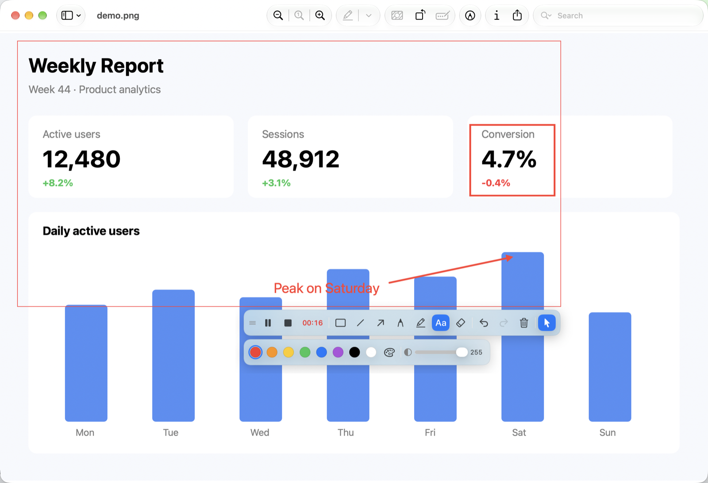
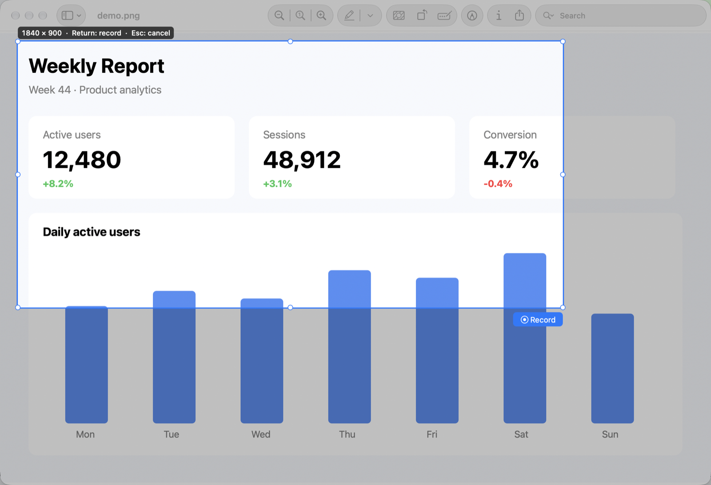
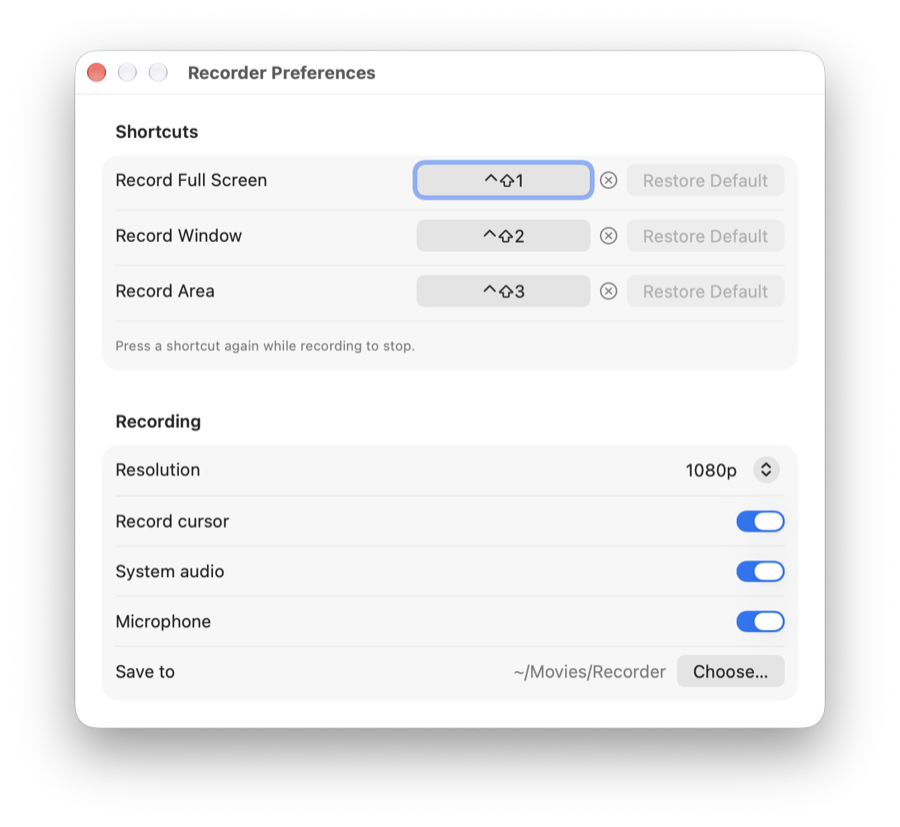

# Recorder

Recorder is a free, open-source macOS menu-bar screen recorder. It records the full screen, a window, or an area to MP4, and lets you draw on the screen while recording.

| Selecting an area | Preferences |
|---|---|
|  |  |

## Features

- **Three modes:** record the full screen, one window, or a custom area.
- **Live annotation:** draw rectangles, lines, arrows, pencil and marker strokes, and text while recording. Drawings appear in the video and are removed when the recording stops.
- **Pause and resume:** paused time is left out of the video.
- **Audio:** record system audio, the microphone, or both mixed into one track.
- **Resolution:** 720p, 1080p, or 4K, keeping the aspect ratio and never upscaling.
- **Cursor:** choose whether the mouse cursor is recorded, even during a recording.
- **Clean output:** the recording frame, toolbox, and notices never appear in the video.
- **Configurable** shortcuts, resolution, audio, and output folder. Appearance follows the system light/dark setting and accent color.

## Installation

Requirements: macOS 27 or later on Apple Silicon.

1. Download `Recorder-<version>.dmg` from the [latest release](https://github.com/lvcas0x1/recorder/releases/latest).
2. Open the DMG and drag **Recorder** to **Applications**.
3. Open Recorder once. The app is not notarized, so macOS blocks it the first time: go to **System Settings > Privacy & Security** and click **Open Anyway**.
4. Grant **Screen Recording** in **System Settings > Privacy & Security > Screen & System Audio Recording**. Recorder shows an onboarding window until it is granted.
5. On the first recording, macOS may ask whether Recorder may bypass the system's private window picker. Choose **Allow**.
6. **Microphone** permission is asked the first time you record with Microphone on. If it is denied, the recording continues without the microphone.

The Screen Recording and Microphone permissions must be granted again after each update.

Recorder has no Dock icon. Look for the record icon in the menu bar. While recording, the menu-bar item shows the elapsed time, and clicking it stops the recording. If you use a menu-bar manager (Ice, Bartender, and so on), set Recorder to always show.

## Usage

### Start and stop

| Mode | Default shortcut | How |
|---|---|---|
| Full screen | ⌃⇧1 | Records the display under the mouse pointer right away |
| Window | ⌃⇧2 | Move over a window (it is highlighted) and click it |
| Area | ⌃⇧3 | Drag a rectangle, adjust it with the handles or by dragging, then press Return or click Record |

- Esc or a right-click cancels a selection.
- Press any of the three shortcuts again while recording (or paused) to stop.
- The same actions are in the menu-bar menu.

In window and area modes, a thin red frame marks the recorded area.

### Toolbox

A toolbox appears at the bottom right of the recorded area (bottom center of the display in full-screen mode). Drag it by its grip (≡).

| Action | How |
|---|---|
| Pause / resume, stop | Toolbox buttons |
| Draw | Pick rectangle, line, arrow, pencil, marker, or text |
| Line or polyline | Drag for a single line, or click points and right-click to finish |
| Switch line / arrow | Tab |
| Text | Click to place, type, Esc to finish; drag a corner to scale and the top handle to rotate |
| Erase | Pick the eraser, then click a drawing or drag across several |
| Pen width (1–24 pt) | Slider, scroll wheel, or the 1 / 2 keys |
| Color | Palette, custom color, and alpha (0–255) |
| Undo / redo / clear all | ⌘Z / ⌘Y / ⇧⌘Z |
| Record cursor on/off | Cursor button |
| Stop drawing | Esc, or click the tool again |

While no tool is active, clicks and typing go to the apps under the recorded area.

### Output

- MP4 (H.264) saved to `~/Movies/Recorder` as `Recording yyyy-MM-dd HH.mm.ss.mp4`. Existing files are never overwritten.
- After saving, a notice shows the file name with a **Show in Finder** button.

### Preferences

Open **Preferences** (⌘,) from the menu-bar menu to change or remove the shortcuts, and set the resolution, Record Cursor, System Audio, Microphone, and output folder.

## Known limitations

- Window mode records the area where the window was when recording started; a moved or resized window is not followed.
- In window mode, System Audio records only the sound of the recorded window's app.
- Area mode is limited to one display.
- Behavior with two displays has not been checked on physical hardware.
- The default shortcuts may conflict with other apps. Change or remove them in Preferences.

## Contributing

Build instructions, project layout, and dependencies: [README-dev.md](README-dev.md).

## License

[MIT](LICENSE)
